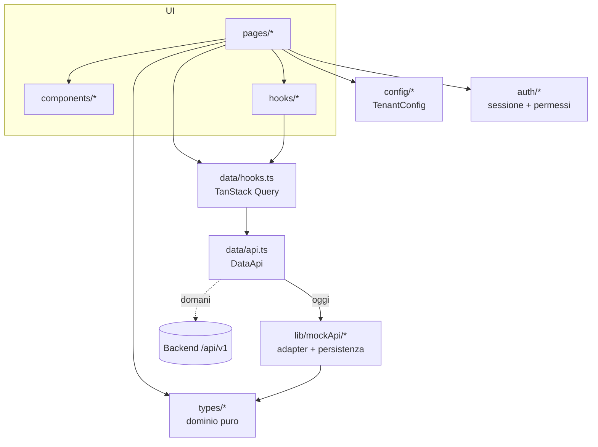

# Architettura del frontend

## Obiettivi
1. **Prodotto vendibile e personalizzabile**: ogni cliente (tenant) cambia brand,
   colori, moduli, tabelle e numerazioni senza toccare il codice dei moduli.
2. **Backend sostituibile**: oggi i dati vengono da adapter mock persistiti nel
   browser; il passaggio al backend (Supabase/Postgres, spec v3.1) sostituisce
   un solo file.
3. **Correttezza di dominio verificabile**: regole di magazzino, documenti e
   importi sono funzioni pure coperte da test.

## Layer

| Layer | Cartella | Responsabilità | Dipende da |
|---|---|---|---|
| Pagine | `pages/` | composizione di una schermata, stato UI (filtri nell'URL, modali) | componenti, hook, data, dominio |
| Componenti | `components/` | UI riutilizzabile (`data/`, `documenti/`, `ui/`) e per modulo | dominio, config, i18n |
| Data | `data/` | contratti (`contracts.ts`), selezione adapter (`api.ts`), query/mutation con invalidazioni e audit (`hooks.ts`) | adapter, dominio |
| Adapter | `lib/mockApi/` | "server" simulato: transazioni, numerazioni, vincoli | dominio, config |
| Dominio | `types/` | entità, macchine a stati, calcoli (totali, IVA, costo medio, aging) | `lib/money`, `lib/stateMachine` |
| Config | `config/` | tenant, tema, numerazioni | — |
| Auth | `auth/` | sessione, permission matrix §5, guard | adapter utenti |

Le regole di dipendenza sono **test**, non convenzioni: `app/architecture.test.ts`
fallisce se una pagina importa un mock o se il dominio importa React.

## Flusso di una mutation
1. La pagina chiama un hook (`useCambiaStatoOrdine`) passando solo il feedback (toast).
2. L'hook esegue `api.ordini.cambiaStato`, invalida le query interessate
   (ordini **e** giacenze/movimenti, perché la conferma scarica il magazzino)
   e dichiara la voce di registro attività (`meta.audit`).
3. Il `MutationCache` (`lib/queryClient.ts`) scrive l'audit con l'utente corrente
   e persiste i mock.

## Decisioni
| Decisione | Motivo |
|---|---|
| **Stato derivato, mai persistito** (stato scorta, totali documento, ritardi, crediti, statistiche cliente) | un flag salvato diverge dal dato che lo determina |
| **Snapshot nei documenti** (righe, cliente in fattura) | un documento emesso racconta cosa riportava, anche se l'anagrafica cambia |
| **Importi in centesimi interi** (`lib/money.ts`, half-up) | spec §10: niente `Number` come risultato fiscale |
| **IVA per aliquota** (FatturaPA DatiRiepilogo) | l'imposta si calcola sul totale per aliquota, non per riga |
| **Macchine a stati dichiarative** (`lib/stateMachine.ts`) | transizioni in tabella, verificabili, uguali in UI e adapter |
| **Unico punto di scrittura delle giacenze** (`movimenta()`) | registro movimenti e giacenze non possono divergere |
| **Numerazione fiscale all'emissione, nell'adapter** | spec §11: mai offline-optimistic; il client propone, il server assegna |
| **Filtri ed elenchi nell'URL** (`useListState`) | link condivisibili, back del browser |
| **Permessi in UI = nascondere, non autorizzare** | l'autorizzazione reale è RLS/RPC lato server (spec §5) |
| **i18n senza dipendenze, chiavi tipizzate** | chiavi errate non compilano; bundle minimo |
| **Token CSS + tema runtime** | white-label senza rebuild; `-rgb` derivati dai colori del tenant |

## Test
| Tipo | Dove | Cosa garantisce |
|---|---|---|
| Dominio | `types/*.test.ts`, `lib/*.test.ts` | calcoli, transizioni, golden test importi |
| Adapter | `lib/mockApi/*.test.ts` | effetti combinati (ricevimento → carico + costo medio; emissione → numero; SDI) |
| Permessi | `auth/permissions.test.ts` | ogni cella della matrice §5 |
| Architettura | `app/architecture.test.ts`, `styles/tokens.test.ts` | dipendenze fra layer, niente colori letterali |
| Smoke UI | `app/smoke.test.tsx` (jsdom) | ogni modulo si monta per ogni ruolo; guard, permessi, tenant, ricerca, notifiche |

E2E con Playwright e test di componente mirati: con lo step backend (spec §1).
